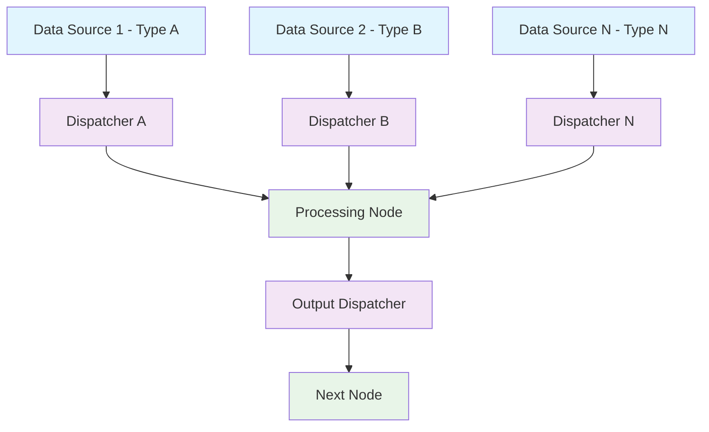

# Conduit - Reactive Dispatcher Framework

Conduit is a high-performance, low-latency reactive framework designed for building event-driven data processing pipelines. The framework enables the creation of nodes that can subscribe to multiple dispatchers with different data types, allowing for complex data flow processing with heterogeneous inputs.

## Overview

Conduit provides a flexible and type-safe approach to reactive programming where:

- **Dispatchers** emit data to subscribed nodes
- **Nodes** can accept multiple inputs of different types and process them accordingly
- **Event-driven architecture** ensures data flows through the system in response to events
- **Glitch-free, deterministic execution**: single-threaded graphs run in topological order, each node at most once per event
- **Cross-thread hand-off** through the LMAX Disruptor ring buffer

## Features

- **Low-latency processing** using the LMAX Disruptor ring buffer
- **Multi-type input support** - nodes can process different data types simultaneously
- **Fluent API** for easy pipeline construction
- **Zero allocation** on the single-threaded dispatch path
- **Explicit error policies** (`HALT`, `SKIP_EVENT`, `LOG_CONTINUE`)
- **Type safety** through generic interfaces
- **Flexible node composition** up to 9 different input types
- **Heterogeneous data processing** with automatic type detection

## Architecture

The framework consists of two core concepts:

1. **Dispatcher** - An interface responsible for dispatching data to subscribers
2. **Node** - Components that subscribe to dispatchers and process data with different callbacks based on source dispatcher and data type

The design supports nodes with up to 9 different input types, each with its own callback method:

- `Node1`, `Node2`, ..., `Node9` - for nodes with 1 to 9 different input types
- `DisruptorNode1`, `DisruptorNode2`, ..., `DisruptorNode9` - Disruptor-based implementations for high-performance scenarios

## Installation

### Maven

```xml
<dependency>
    <groupId>io.github.green-leaves</groupId>
    <artifactId>conduit</artifactId>
    <version>1.0.0</version>
</dependency>
```

### Gradle

```groovy
implementation 'io.github.green-leaves:conduit:1.0.0'
```

## Getting Started

### Example: Basic Usage

```java
import io.lightning.conduit.dispatcher.EventDispatcher;
import io.lightning.conduit.node.DisruptorNode2;

// Create dispatchers for different data types
EventDispatcher<Integer> intDispatcher = EventDispatcher.create();
EventDispatcher<String> stringDispatcher = EventDispatcher.create();

// Create a node that handles two different input types
public static class CombineNode extends DisruptorNode2<Integer, String> {
    @Override
    protected void onEvent1(Integer event) {
        System.out.println("Received integer: " + event);
    }

    @Override
    protected void onEvent2(String event) {
        System.out.println("Received string: " + event);
    }
}

// Initialize and connect components
CombineNode combineNode = new CombineNode();
combineNode.subscribe1(intDispatcher);
combineNode.subscribe2(stringDispatcher);
combineNode.start();

// Dispatch data
intDispatcher.dispatch(42);
stringDispatcher.dispatch("Hello, Conduit!");
```

### Example: Complex Pipeline

```java
// Create multiple dispatchers for different data types
EventDispatcher<Price> priceDispatcher = EventDispatcher.create();
EventDispatcher<Rate> rateDispatcher = EventDispatcher.create();
EventDispatcher<Volume> volumeDispatcher = EventDispatcher.create();

// Create a node that processes three different input types
public static class FinancialProcessor extends DisruptorNode3<Price, Rate, Volume> {
    @Override
    protected void onEvent1(Price price) {
        // Process price data
    }

    @Override
    protected void onEvent2(Rate rate) {
        // Process rate data
    }

    @Override
    protected void onEvent3(Volume volume) {
        // Process volume data
    }
}

// Create and configure the processor
FinancialProcessor processor = new FinancialProcessor();
processor.subscribe1(priceDispatcher)
         .subscribe2(rateDispatcher)
         .subscribe3(volumeDispatcher);
processor.start();

// Dispatch data to trigger processing
priceDispatcher.dispatch(new Price(100.0));
rateDispatcher.dispatch(new Rate(0.05));
volumeDispatcher.dispatch(new Volume(1000));
```

## Key Components

### Dispatchers

`EventDispatcher` is backed by a `ListenerRegistry` (a copy-on-write array, so dispatch neither locks nor allocates):
- `dispatch(E event)` - run the event through the graph (see *Execution model*)
- `register(Listener<E>)` / `unregister(...)` / `clear()` - registering the same instance twice has no effect
- `getListeners()` - read-only snapshot

A node that also produces output implements `EventDispatcher` and holds its own registry:

```java
class Normalizer extends Node1<Tick> implements EventDispatcher<Rate> {
    private final ListenerRegistry<Rate> listeners = new ListenerRegistry<>();
    @Override public ListenerRegistry<Rate> listeners() { return listeners; }
    @Override protected void onEvent1(Tick t) { dispatch(toRate(t)); }
}
```

### Nodes

- `subscribe1()` ... `subscribe9()` - wire inputs (rejected once the node is started)
- `start()` - validates every input is wired (fails fast), detects cycles, places the node in the graph. Idempotent.
- `stop()` - unsubscribes; the node can be re-wired and started again. Idempotent.
- `onEvent1()` ... `onEvent9()` - per-input handlers
- `onTrigger()` - called once per cycle after all of the cycle's inputs; return `false` to report "no change"
- `afterEvent()` - end-of-cycle hook, e.g. publish once per tick
- `errorPolicy(ErrorPolicy)` - per-node failure handling

## Execution model (single-threaded nodes)

Each external `dispatch` runs one **cycle**:

1. Nodes are ranked topologically at `start()` (1 + highest upstream rank; ties broken by start order).
2. Dirty nodes run in rank order, each **at most once per cycle**, after every upstream node that fed it has finished. All of the node's inputs for the cycle are delivered in arrival order, then `onTrigger()` runs once. A diamond (`tick -> A`, `tick -> B`, `Hedger(A, B)`) therefore fires `Hedger` once with both `A` and `B` updated.
3. Everything a node dispatches is staged and released to its children when the node finishes. If `onTrigger()` returns `false` the staged output is dropped, so unchanged branches are skipped.
4. `afterEvent()` runs on every node that changed, after all nodes have run.

Dispatching from inside a handler never recurses. A node's output to its own children stays in the current cycle. Anything else, such as dispatching upstream or into a plain dispatcher, is queued and runs as a follow-up cycle before the outer `dispatch` returns. Feedback loops are bounded by `Conduit.maxChainedCycles(...)`.

A synchronous graph must be driven by one thread at a time; use a Disruptor node as the thread boundary.

### Error handling

| `ErrorPolicy` | Behaviour |
|---|---|
| `HALT` (default) | Abort the cycle, discard pending work, throw `ConduitException` to the `dispatch` caller. The graph stays usable. |
| `SKIP_EVENT` | Discard what the failing handler dispatched, continue the cycle. No logging. |
| `LOG_CONTINUE` | Log WARN and continue; output dispatched before the failure is kept. |

Set per node with `node.errorPolicy(...)` or globally with `Conduit.defaultErrorPolicy(...)`. Every failure is also reported to `Conduit.errorHandler(...)` and counted in `Conduit.errorCount()`.

## Disruptor nodes

`DisruptorNodeN` runs handlers on a dedicated consumer thread fed by a ring buffer:

```java
node.bufferSize(1024)                                   // power of 2
    .waitStrategy(new BusySpinWaitStrategy())           // default; one busy core per node
    .producerType(ProducerType.MULTI)                   // SINGLE if all inputs are fed from one thread
    .threadFactory(r -> pinnedThread(r))                // e.g. core affinity
    .backpressure(DisruptorComponent.Backpressure.BLOCK) // or DROP (counted in droppedCount())
    .subscribe1(feed)
    .start();
```

- Handler failures never kill the consumer thread. Under `HALT` the node is marked halted: it keeps draining (so producers never stall on a full ring) and further dispatches to it throw `ConduitException`.
- `stop()` unsubscribes, drains in-flight events (up to 5 s) and stops the thread; `halt()` stops immediately.
- `onTrigger()`/`afterEvent()` run at the end of each batch drained from the ring.
- Ring slots release their payload after handling. Payloads are ordinary heap objects, not preallocated slots.

## Performance

JMH, single thread, 16-core Windows desktop, JDK 21 (`-prof gc`):

| Scenario | ns/op | B/op |
|---|---|---|
| plain listener | 6.9 | 0 |
| 1 hop | 15.1 | 0 |
| 5-hop chain | 80.4 | 0 |
| diamond (2 branches + join) | 54.8 | 0 |

`AllocationTest` asserts that steady-state dispatch allocates nothing. To run the benchmarks:

```bash
mvn -q test-compile dependency:build-classpath -Dmdep.includeScope=test -Dmdep.outputFile=target/cp.txt
java -cp "target/test-classes:target/classes:$(cat target/cp.txt)" org.openjdk.jmh.Main DispatchBenchmark -prof gc
java -cp "target/test-classes:target/classes:$(cat target/cp.txt)" io.lightning.conduit.bench.LatencyHarness
```
(On Windows use `;` as the path separator. `System.nanoTime` resolution there is 100 ns, which makes the latency harness coarse.)

## Upgrading from 1.0.0

- `EventDispatcher` implementors return a `ListenerRegistry` from `listeners()` instead of a mutable `List` from `getListeners()`.
- The default error policy is `HALT`: a failing handler now throws `ConduitException` out of `dispatch`. Use `Conduit.defaultErrorPolicy(ErrorPolicy.SKIP_EVENT)` for the old keep-going behaviour, without the logging.
- Downstream handlers run after the dispatching handler returns, not inside its `dispatch` call.
- Calling `subscribeN` on a started node throws; `stop()` it first.

## Dependencies

- Java 21+
- LMAX Disruptor 4.0.0
- SLF4J API for logging
- Test only: JUnit 5, Logback, JMH, HdrHistogram

## Building and Running

### Prerequisites

- Java 21 or higher
- Maven 3.6.0 or higher

### Build

```bash
mvn clean install
```

## Use Cases

Conduit is ideal for:

- **Financial systems** - Processing market data feeds with different instruments
- **Real-time analytics** - Aggregating multiple data streams
- **IoT applications** - Handling sensor data from multiple sources
- **Event-driven architectures** - Building reactive microservices

## License

This project is licensed under the Apache License 2.0 - see the [LICENSE](LICENSE) file for details.

## Architecture Diagram

